# Derivative Term-sheet Analyser

A Python automation project developed for UBS Tomorrow Talent Program in January 2026. The topic was provided by UBS Shanghai Global Markets Professionals。It aims to save structurers from reading the long and complex termsheet word by word.

It reads a term-sheet PDF of an exotic product, extracts terms and dates with an LLM, explains the product structure, saves analysis and payoff charts, and outpouts key parameters for pricing.

Team members: WANG Ruotong, CHEN Hongyu, LIU Haolin, PING An, and TAN Xin Wei. This is a prototype, not a commercial product.

## Start here

Read `termsheet_analyser/workflow.py` first. It connects the numbered modules:

| File | Responsibility |
| --- | --- |
| `step01_pdf.py` | Read PDF text and issuer hints |
| `step02_extraction.py` | Extract and normalise terms and dated events |
| `step03_structure.py` | Interpret classification, payoff logic and lifecycle |
| `step04_scenarios.py` | Generate illustrative scenario points |
| `step05_visualization.py` | Save lifecycle and scenario charts |
| `step06_parameters.py` | Build experimental pricing parameters |
| `step07_pricing.py` | Run experimental Monte Carlo pricing and Greeks |
| `step08_reporting.py` | Save experimental HTML, JSON and PDF reports |

`config.py` reads environment configuration; `prompts.py` contains the LLM prompts. `cli.py` parses command-line arguments, and `__main__.py` starts that command. The single application entry point is **`python -m termsheet_analyser`**, run from the repository root.

Default workflow: PDF -> terms and event tables -> structure -> illustrative charts and saved analysis. Steps 06-08 run only when `--include-pricing` is supplied. Their known financial-model limitations are documented in [docs/CODE_REVIEW.md](docs/CODE_REVIEW.md).

## Run in VS Code on Windows

1. Open this repository folder in VS Code, and install the recommended Python and Python Debugger extensions.
2. In the integrated PowerShell terminal, create the environment and install dependencies:

```powershell
py -3.11 -m venv .venv
.\.venv\Scripts\python.exe -m pip install -r requirements.txt
```

Python 3.11 or newer is supported; adjust the Python launcher version if necessary. Use **Python: Select Interpreter** from the Command Palette and choose `.venv\Scripts\python.exe`.

3. Check the command without any API or private document:

```powershell
.\.venv\Scripts\python.exe -m termsheet_analyser tags examples/synthetic_termsheet.txt
```

4. Create `private_inputs`, put your authorised PDF there, and configure the model in this terminal. The secure prompt below avoids typing the key directly into shell history:

```powershell
$keyInput = Read-Host 'API key' -AsSecureString
$env:TERMSHEET_API_KEY = [System.Net.NetworkCredential]::new('', $keyInput).Password
$env:TERMSHEET_BASE_URL = 'https://api.siliconflow.cn/v1'
$env:TERMSHEET_MODEL = 'deepseek-ai/DeepSeek-V3.2'
.\.venv\Scripts\python.exe -m termsheet_analyser analyse private_inputs/example.pdf --output outputs --no-charts
```

Choose an endpoint/model available to your account. `.env.example` documents variable names; the Python command does not automatically load `.env` files. API analysis sends PDF text to the selected provider. The key remains in the local process environment, not in source code.

To render charts, remove `--no-charts`. Lifecycle diagrams additionally require the Graphviz system executable (`dot`) on PATH; installing the Python package alone is insufficient. Without it, lifecycle rendering produces a warning. Scanned PDFs require OCR before use; this project does not implement OCR. Oversized PDFs are rejected instead of silently truncated.

### Run or debug with F5

The included `.vscode/launch.json` provides **Offline tags** and **Analyse PDF** configurations. Select one in Run and Debug, then press F5. Analyse PDF asks for a path and defaults to `--no-charts`; edit its arguments to enable charts.

For API debugging, create a local `.env` file using `.env.example` as a template and enter your key locally. The VS Code debugger loads this file through `envFile`; it is ignored by Git. Environment variables set only inside an integrated terminal do not automatically propagate back to the debugger. Never put a key in `launch.json`.

Do not run individual `step*.py` files with Run Python File: they are modules called by the workflow, not separate applications. Use the module command or the F5 configuration.

## Outputs

`outputs/` contains extracted text, key-term and event CSVs, `analysis.json`, and any generated figures. Open these files directly from VS Code or your file browser.


### Example output: parameter extraction (Task 1)

The following screenshots reproduce the saved display outputs of the [original project run](https://colab.research.google.com/drive/1Usc3Koy1pVuQhrnwVX5N4xpwb9xHzLi9). They are historical examples, not a fresh run of the refactored Python application. Original values and labels are preserved.

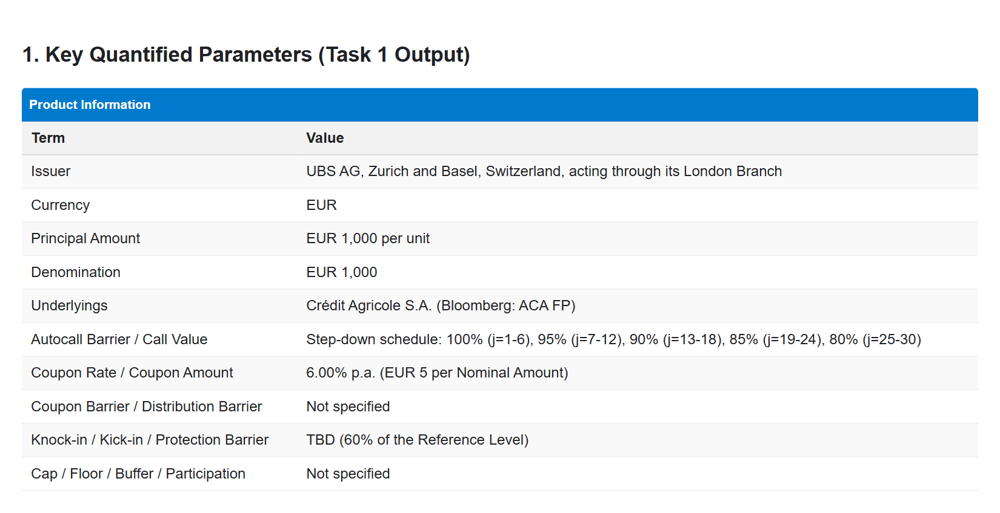

<details>
<summary>Extracted observation, coupon and maturity dates</summary>

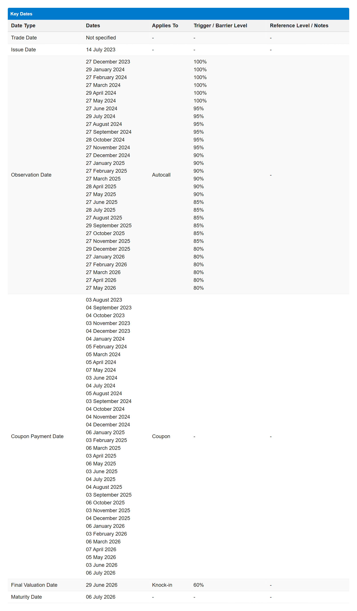

</details>

### Example output: structure and payoff analysis (Task 2)

**Product classification**

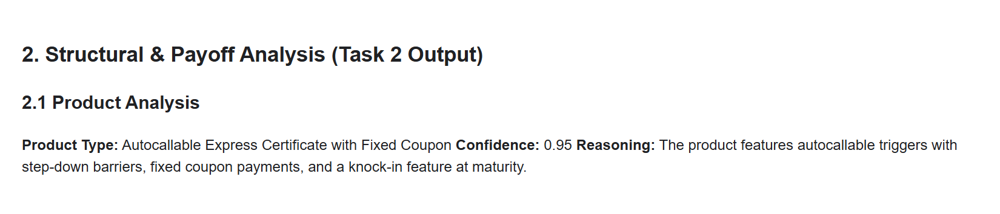

**Lifecycle and logic flow**

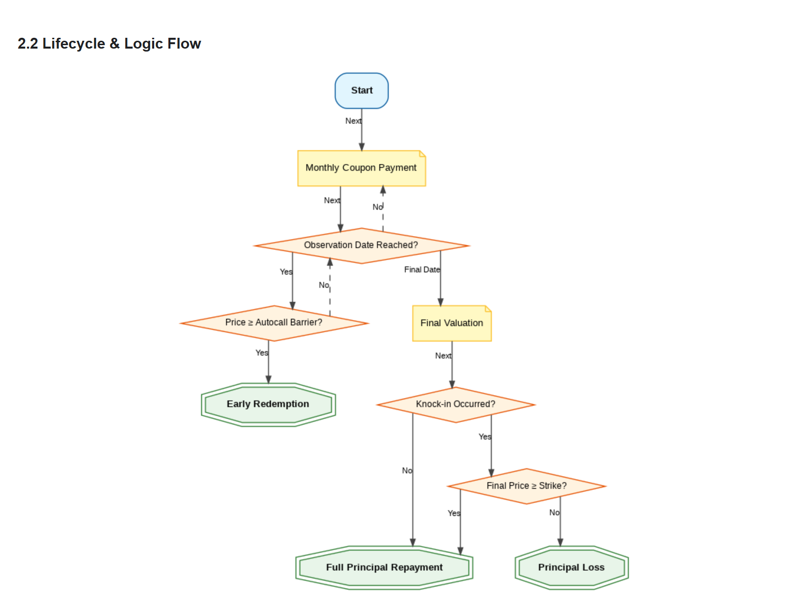

**Redemption logic**

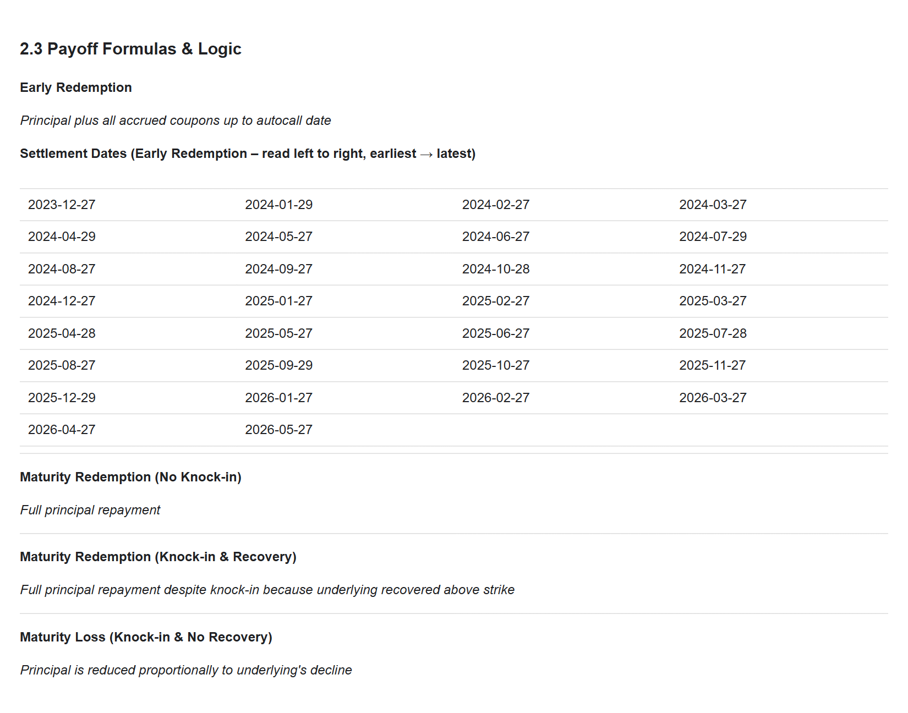

**Illustrative market scenarios**

These are constructed paths for explaining payoff branches, not observed prices or estimated outcome probabilities. Scenario labels, coupon counts and barrier-monitoring assumptions are reproduced from the original output and have not been independently validated against the term sheet.

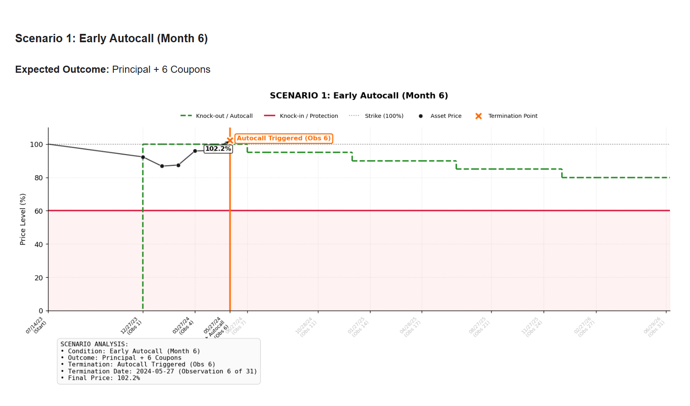

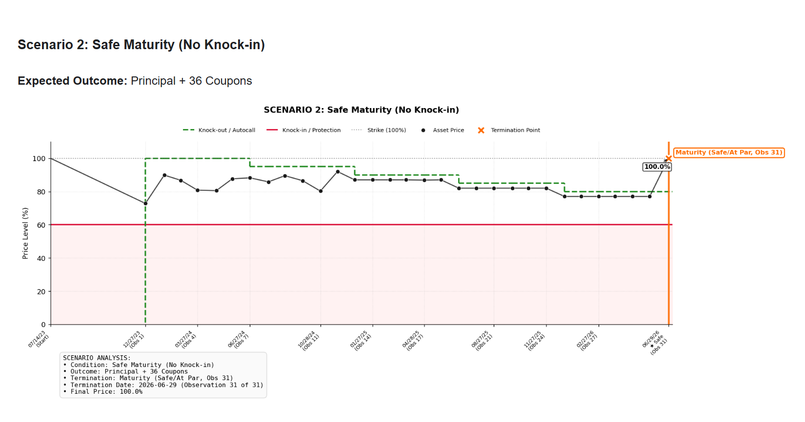

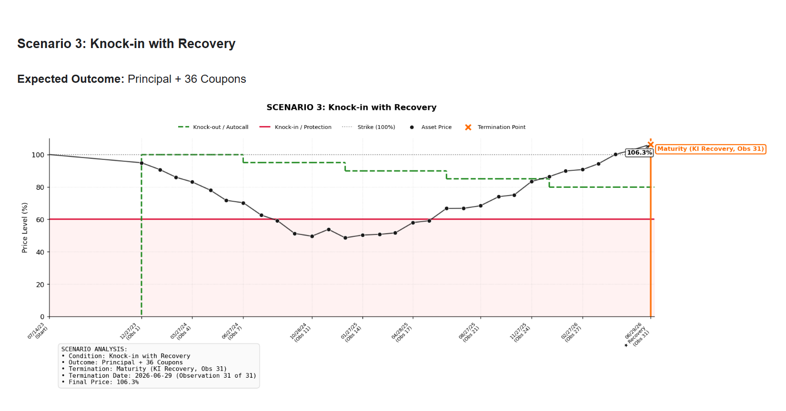

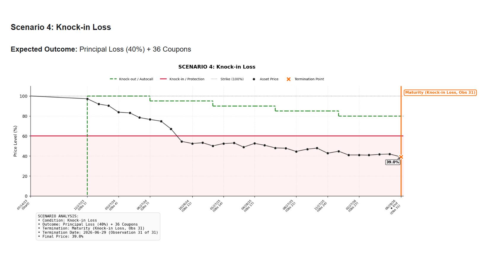

### Example output: experimental pricing (Task 3)

These screenshots document the original prototype interface, not validated valuations, Greeks or portfolio risk estimates. The original run reported a pricing-methodology fallback, and its pricing configuration labels the coupon as conditional while Task 2 describes a fixed coupon. The displayed VaR/ES are prototype simulation outputs, not validated one-day market-risk measures. See [known model limitations](docs/CODE_REVIEW.md).

**Simulation configuration and assumed inputs**

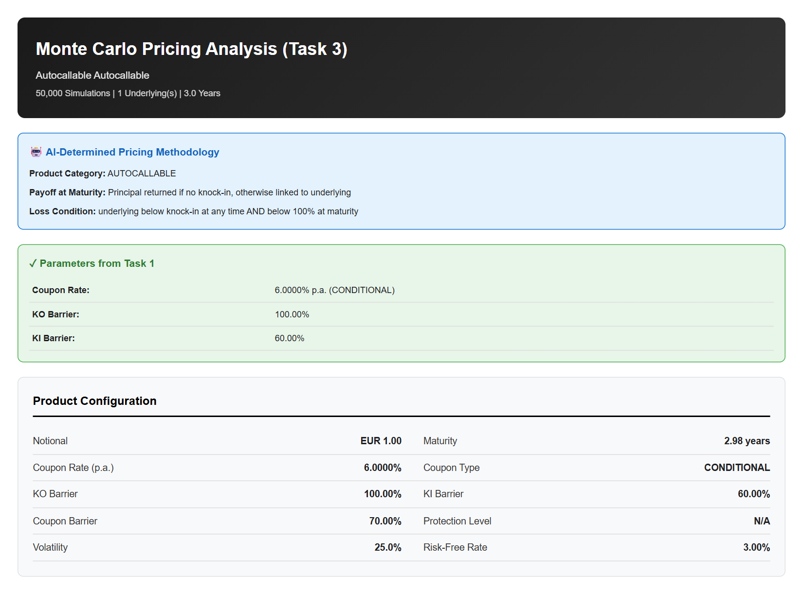

**Valuation and scenario probabilities**

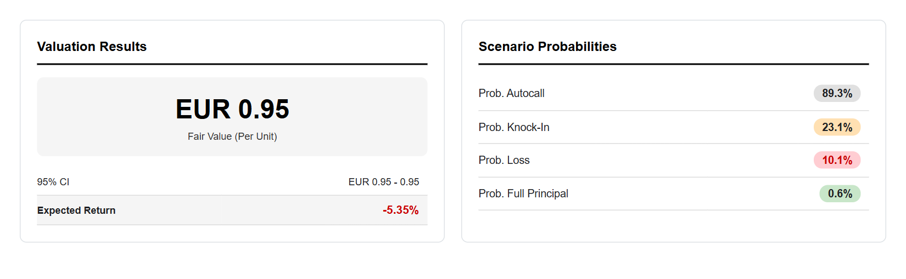

**Greeks and risk-metric display**

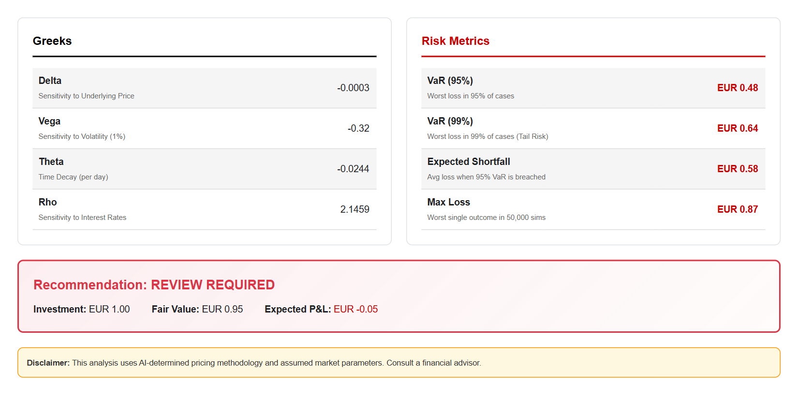


Experimental pricing can be enabled explicitly:

```powershell
.\.venv\Scripts\python.exe -m termsheet_analyser analyse private_inputs/example.pdf --output outputs --include-pricing
```

This also saves `comprehensive_report_*.html`, `.json` and, if PDF generation succeeds, `.pdf`. Pricing, Greeks and risk measures are not validated financial outputs; read the code review first.

## Other files

| Path | Purpose |
| --- | --- |
| `requirements.txt` | Python dependencies |
| `.env.example` | Configuration variable names, without a real key |
| `.gitignore` | Excludes credentials, private PDFs, generated outputs and local environments |
| `.vscode/` | Editor run/debug configuration and recommended extensions |
| `tests/` | Offline automated software checks |
| `examples/` | Synthetic input text |
| `tools/diagnose_pricing.py` | Reproduces known pricing defects |
| `docs/CODE_REVIEW.md` | Fixed runtime defects and remaining model limitations |
| `.github/workflows/check.yml` | Runs automated checks on pushes and pull requests |

## Checks

```powershell
.\.venv\Scripts\python.exe -m unittest discover -s tests -v
.\.venv\Scripts\python.exe -m tools.diagnose_pricing
```

Tests use synthetic inputs and mocked API responses. They verify software behaviour, not real-document extraction accuracy or financial-model correctness. The diagnostic deliberately reports known defects and is not a valuation benchmark.

This repository contains no ASTRI source or data. Embedded credentials from the supplied source are excluded; old credentials should be rotated separately. No licence is granted on behalf of other contributors.
