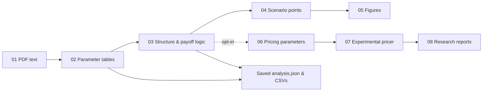

# Derivative Term-sheet Analyser

The complete Team C research notebook, reorganised into Python modules in workflow order. This repository contains the PDF extraction, LLM analysis, scenario visualisation, experimental pricing and reporting code — not a portfolio website or a replacement demonstration.

Developed for the UBS Tomorrow Talent Program. Team members in the supplied deck: CHEN Hongyu, LIU Haolin, PING An, TAN Xin Wei and WANG Ruotong (Elleny). This is a team research prototype, not a UBS product. Module ownership is not asserted as solely Elleny's.

**Start with [`workflow.py`](termsheet_analyser/workflow.py), then read the numbered modules below.** The [code review](docs/CODE_REVIEW.md) explains confirmed bugs, fixes and remaining model limitations.

## Read the code in this order

| Order | File | Input → output |
| --- | --- | --- |
| 01 | [`step01_pdf.py`](termsheet_analyser/step01_pdf.py) | PDF → text and issuer hint |
| 02 | [`step02_extraction.py`](termsheet_analyser/step02_extraction.py) | Text → key terms, date/event rows and structural hints |
| 03 | [`step03_structure.py`](termsheet_analyser/step03_structure.py) | Source text + tables → product classification, payoff logic and lifecycle specification |
| 04 | [`step04_scenarios.py`](termsheet_analyser/step04_scenarios.py) | Scenario definitions + schedule → illustrative observation points |
| 05 | [`step05_visualization.py`](termsheet_analyser/step05_visualization.py) | Structure and points → lifecycle and scenario figures; notebook table styling |
| 06 | [`step06_parameters.py`](termsheet_analyser/step06_parameters.py) | Terms + methodology → typed pricing parameters |
| 07 | [`step07_pricing.py`](termsheet_analyser/step07_pricing.py) | Parameters → research Monte Carlo values, Greeks and risk summaries |
| 08 | [`step08_reporting.py`](termsheet_analyser/step08_reporting.py) | Research outputs → HTML, JSON and PDF reports |

Supporting modules: [`config.py`](termsheet_analyser/config.py) reads environment variables; [`prompts.py`](termsheet_analyser/prompts.py) holds the LLM prompts; [`presentation.py`](termsheet_analyser/presentation.py) separates notebook display from computation. [`notebook_view.py`](termsheet_analyser/notebook_view.py) retains the original notebook-style orchestration for compatibility.



No original top-level workflow definition was silently dropped. The [source map](docs/source-map.json) records destinations and line ranges in the previous sanitised source. The old 3,000+ line `research_pipeline.py` is now a short import adapter; the notebook imports modules rather than repeating all source code.

## Run

Requires Python 3.11+.

```sh
python -m venv .venv
# Activate the environment using your platform's usual command.
python -m pip install -r requirements.txt
```

For lifecycle figures, install the Graphviz system executable and ensure `dot` is on PATH. Use `--no-charts` if you only need structured extraction and analysis.

Set `TERMSHEET_API_KEY`, `TERMSHEET_BASE_URL` and `TERMSHEET_MODEL` in your shell. `.env.example` documents the names; `.env` files are not loaded automatically. Choose a model and endpoint available to your account. No API key is embedded in source, and imports do not make network requests.

```sh
python -m termsheet_analyser analyse private_inputs/example.pdf --output outputs
python -m termsheet_analyser analyse private_inputs/example.pdf --output outputs --no-charts
```

The default workflow performs text extraction and structural analysis, preserving event-level date rows. It writes `02_raw_extraction.txt`, `02_key_terms.csv`, `02_dates.csv`, `analysis.json` and any rendered figures to the output directory. It stops on invalid extraction or missing structure instead of continuing with fabricated defaults. Long PDFs exceeding the configured context limit are rejected explicitly; OCR is not implemented.

Pricing code is preserved but **opt-in**, because its financial assumptions and Greek calculations are not validated:

```sh
python -m termsheet_analyser analyse private_inputs/example.pdf --output outputs --include-pricing
```

Read [CODE_REVIEW.md](docs/CODE_REVIEW.md) before using this flag. It documents spot/reference normalisation, autocall coupon accrual, event timing, cached Greek results, market-input assumptions and risk-measure interpretation. No valuation-accuracy, investment-return or production-readiness claims are made.

For local inspection without API calls:

```sh
python -m termsheet_analyser tags examples/synthetic_termsheet.txt
python -m unittest discover -s tests -v
python -m tools.diagnose_pricing
```

The last command reproduces known model defects on synthetic inputs. It is a diagnostic, not a passing valuation benchmark.

## Validation

Tests cover module imports, dataclass state, sub-1% conversion, API interface consistency, safe failures, a fixed-coupon reference case and the PDF-to-JSON workflow with synthetic PDFs and mocked model responses. No live model calls, real keys, confidential term sheets or proprietary market data are used. Mocked integration tests verify software wiring; they do not establish extraction accuracy or pricing correctness. The GitHub Actions workflow installs the declared dependencies and runs the same checks.

## Credentials and reuse

The original embedded key strings, notebook outputs, metadata and uploaded documents are excluded. Rotate any formerly embedded keys separately. API inputs are sent to the configured model provider: only use authorised documents. Private inputs, output reports, environments and caches are ignored by Git.

This repository contains no ASTRI source or data. Packaging, module organisation, runtime fixes, orchestration and tests were added to the supplied team notebook. No licence is granted on behalf of other contributors; agree on reuse/publication rights before asserting an open-source licence.
